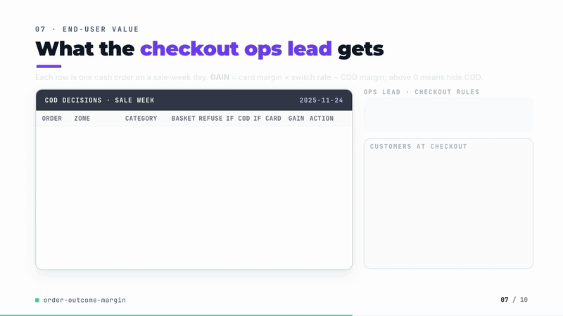
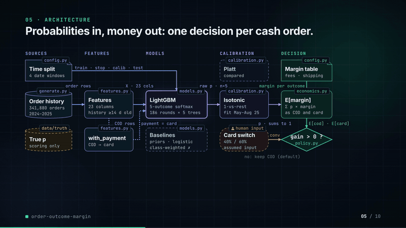
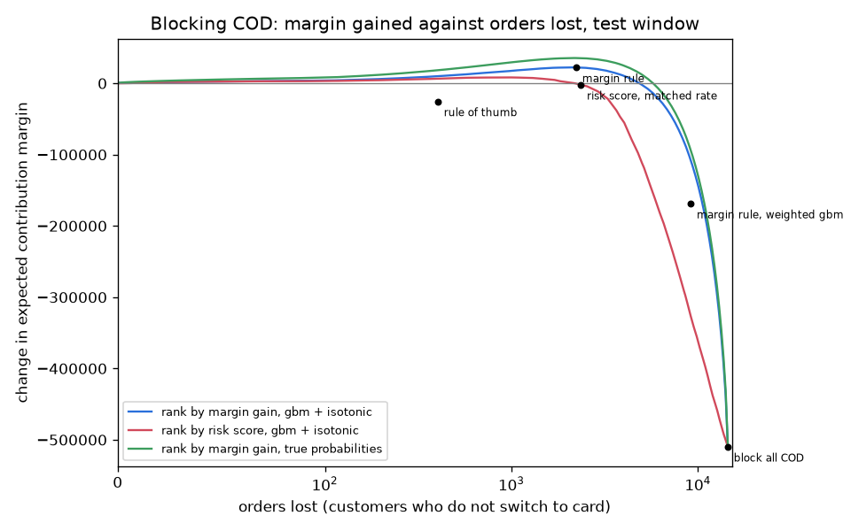

# order-outcome-margin

[](https://github.com/kavya2693/order-outcome-margin/actions/workflows/ci.yml)


Which orders will lose money, how much the day will really earn, and when cash on delivery
should be switched off: a five-outcome order model priced with unit economics.

[](https://kavya2693.github.io/work-demos/order-outcome-margin.mp4)

*88-second silent walkthrough. [Play the full video](https://kavya2693.github.io/work-demos/order-outcome-margin.mp4) · [download the MP4, 5.5 MB](docs/demo/demo.mp4).*

📄 **Audit report:** every figure and assumption in the video, traced to its source — [PDF](docs/demo/AUDIT_REPORT.pdf) · [Word](docs/demo/AUDIT_REPORT.docx) · [Markdown](docs/demo/AUDIT_REPORT.md)

## At a glance

| | |
|---|---|
| **Problem** | A marketplace ships about 470 orders a day, half of them cash on delivery. One in five orders does not end as a clean delivery, and returns, cancellations, refused parcels and fraud chargebacks each cost a different amount. Finance forecasts the day's margin from flat last-quarter rates; operations switches COD off with a rule of thumb. |
| **Approach** | One LightGBM model predicts all five outcomes, calibrated on a window it never saw. A separate unit-economics table prices every order under every outcome, so expected margin is a dot product. COD is blocked when the card version of the order, times the chance the customer switches, is worth more than the COD version. |
| **Result** | Test window, 73,024 orders over 122 days. Margin rule on 35,389 COD orders: **+22,258 (+0.72%)**, against **-2,113** for a risk score at the same block rate (difference 24,371, bootstrap 95% CI 21,580 to 27,556). Sale-week daily margin error: **4.3%** against **22.5%** for finance's flat rates. |
| **What didn't win** | LightGBM barely beats logistic regression (log-loss 0.6469 against 0.6475). Isotonic calibration did nothing for the plain booster. Class weighting, the usual fix for a low macro-F1, put the four-month margin forecast 183% below realized. If real card conversion is 20 points below the assumed rate, the COD gain falls to +944. |

## Architecture

```mermaid
flowchart LR
    subgraph SRC["Sources"]
        WORLD["Outcome process<br/>world.true_proba"]
        GEN["Seeded generator<br/>scripts/generate_data.py<br/>generate.py"]
        ORD[("data/orders.csv.gz<br/>341,880 orders")]
        TRUTH[("data/truth/order_truth.csv.gz<br/>true p, actual and card")]
        CFG[("Unit economics, time split<br/>config.py")]
    end

    subgraph FEAT["Data and features"]
        LOAD["Loader + four time windows<br/>pipeline.load · split_masks"]
        HIST["Customer history, 14-day lag<br/>features.customer_history"]
        BUILD["23 model features<br/>features.build_features"]
        SWITCH["Same order paid by card<br/>features.with_payment"]
    end

    subgraph MOD["Models"]
        PRIOR["Class priors<br/>models.PriorModel"]
        LOGIT["Multinomial logistic<br/>models.LogitModel"]
        GBM["LightGBM, 5-class softmax<br/>models.GBMModel"]
        CAL["Isotonic / Platt, one-vs-rest<br/>calibration.py"]
    end

    subgraph DEC["Decision"]
        ECON["Margin under each outcome<br/>economics.outcome_margins"]
        EM["Expected margin per order<br/>economics.expected_margin"]
        CONV["Card conversion 40% / 60%<br/>assumed input · policy.conversion_rate"]
        RULE["COD margin rule<br/>block when gain is positive<br/>pipeline.run"]
        RISK["Risk-score baseline<br/>policy.risk_score"]
    end

    subgraph EVAL["Evaluation"]
        MET["log-loss · macro-F1 · classwise ECE<br/>calibration.py"]
        DAY["Daily margin error vs realized<br/>pipeline._daily_errors"]
        SCORE["Policy scored on true p<br/>policy.score_policy · frontier"]
        SENS["Conversion sensitivity + bootstrap CI<br/>pipeline.run"]
    end

    subgraph OUT["Outputs"]
        REP["Report + figures<br/>report.py · plots.py"]
        FILES[("outputs/<br/>report.md · metrics.csv · policy.csv · results.json")]
    end

    WORLD -->|"5 probabilities per order"| GEN
    GEN --> ORD
    GEN --> TRUTH
    ORD -->|"orders + settled outcomes"| LOAD
    LOAD -->|"orders"| HIST
    HIST -->|"prior return, refusal, cancel rates"| BUILD
    LOAD -->|"order fields"| BUILD
    BUILD -->|"train + early-stop windows"| PRIOR
    BUILD -->|"train Jan 24 - Feb 25"| LOGIT
    BUILD -->|"train Jan 24 - Feb 25"| GBM
    BUILD -->|"COD orders"| SWITCH
    SWITCH -->|"card rows"| GBM
    GBM -->|"raw p, n x 5"| CAL
    LOGIT -->|"raw p, n x 5"| CAL
    CAL -->|"calibrated p, n x 5"| EM
    CFG -->|"fees, margins, resale loss"| ECON
    ECON -->|"margin matrix, n x 5"| EM
    EM -->|"E margin as COD and as card"| RULE
    CONV -->|"share who switch"| RULE
    CAL -->|"P failed + P cancelled"| RISK
    RULE -->|"block flags"| SCORE
    RISK -->|"block flags, same rate"| SCORE
    TRUTH -->|"true p under both payments"| SCORE
    PRIOR -->|"flat rates"| MET
    CAL --> MET
    EM -->|"expected margin per day"| DAY
    SCORE --> SENS
    MET --> REP
    DAY --> REP
    SCORE --> REP
    SENS --> REP
    REP --> FILES

    GBM -.->|"early stop on Mar - Apr 25"| GBM
    RULE -.->|"block rate fixed on May - Aug 25"| RISK
    ORD -.->|"realized_margin"| DAY
    TRUTH -.->|"ceiling arm"| MET
    LOAD -.->|"missing address, device kept as NaN"| BUILD

    classDef data fill:#7fa8ff,stroke:#3d6fd9,color:#0b1020
    classDef model fill:#b9a2ff,stroke:#7a5fd6,color:#0b1020
    classDef decision fill:#3fd8a8,stroke:#1f9c76,color:#0b1020
    classDef evaluation fill:#f2c46d,stroke:#b8902f,color:#0b1020
    classDef risk fill:#ff8a73,stroke:#cc5640,color:#0b1020

    class WORLD,GEN,ORD,CFG,LOAD,HIST,BUILD,REP,FILES data
    class PRIOR,LOGIT,GBM,CAL model
    class ECON,EM,RULE,RISK decision
    class TRUTH,MET,DAY,SCORE,SENS evaluation
    class SWITCH,CONV risk
```





Solid edges are the data flow of one run; dotted edges are the loops, fallbacks and side inputs.
Red nodes are the counterfactual and the assumption the COD result rests on: the card version of
an order comes from switching one feature, and the conversion rate is an input, not a measurement.
The truth file is read only by the evaluation.

### Components

| Component | Responsibility | File |
|---|---|---|
| Order history generator | Two years of orders, customers with hidden return, cancel and refusal tendencies, fraud accounts, calendar events, missing fields; writes orders and the truth file | [`scripts/generate_data.py`](scripts/generate_data.py), [`src/order_margin/generate.py`](src/order_margin/generate.py) |
| Outcome process | The multinomial logit the outcomes are drawn from, under the actual payment and under card | [`src/order_margin/world.py`](src/order_margin/world.py) |
| Constants | Outcome classes, unit economics per category, the four time windows, the card-conversion assumption, the seed | [`src/order_margin/config.py`](src/order_margin/config.py) |
| Features | 20 numeric and 3 categorical columns; customer history from orders settled at least 14 days earlier; the payment switch | [`src/order_margin/features.py`](src/order_margin/features.py) |
| Models | Class priors, multinomial logistic regression, LightGBM (plain and class-weighted), all returning an n x 5 probability matrix | [`src/order_margin/models.py`](src/order_margin/models.py) |
| Calibration and metrics | Isotonic and Platt one-vs-rest with row renormalisation; classwise ECE on equal-mass bins, log-loss, macro-F1, count ratios | [`src/order_margin/calibration.py`](src/order_margin/calibration.py) |
| Unit economics | Margin of every order under each of the five outcomes; expected margin as a dot product | [`src/order_margin/economics.py`](src/order_margin/economics.py) |
| COD policy | Conversion rate, policy scoring on true probabilities, risk score, block-rate matching, frontier | [`src/order_margin/policy.py`](src/order_margin/policy.py) |
| Orchestrator | Split, fit, calibrate, score every variant, run every COD policy, sensitivity and bootstrap, write outputs | [`src/order_margin/pipeline.py`](src/order_margin/pipeline.py), [`src/order_margin/cli.py`](src/order_margin/cli.py) |
| Report and figures | `report.md` tables; reliability, daily margin and policy frontier plots | [`src/order_margin/report.py`](src/order_margin/report.py), [`src/order_margin/plots.py`](src/order_margin/plots.py) |

### Design decisions

The reasoning is recorded in [ADR-0001](docs/adr/0001-calibrated-probabilities-times-unit-economics.md).

| Decision | Options considered | Chosen | Trade-off |
|---|---|---|---|
| Outcome model shape | Four binary models, one per bad outcome; a regressor on margin; one multiclass model | One five-class softmax, so the probabilities sum to one | One model to own instead of four, and no order can be 30% returned and 90% delivered; per-team models would be easier to hand out |
| Where the money lives | Predict margin directly; price outcomes outside the model | `economics.py` prices every order under every outcome; expected margin is the dot product | Finance can change a fee without retraining, and the error splits by outcome; the probabilities must be calibrated for the product to mean anything |
| Calibration | None; temperature scaling; Platt; isotonic | Isotonic and Platt one-vs-rest on May to August 2025, rows renormalised, both reported | A single temperature cannot fix class-specific error; on this data the plain booster needed neither, and isotonic only earned its place after class weighting |
| Rare-class handling | Inverse-frequency class weights; none | No weighting in the shipped model; the weighted variant kept as the comparison | Weighting is the standard fix for low macro-F1 and it pushed predicted fraud to 16 times the observed count; leaving it out keeps macro-F1 low |
| COD block rule | Rule of thumb; rank on P(failed) + P(cancelled); expected gain; causal uplift model | Expected gain, `conversion x E[margin, card] - E[margin, COD] > 0`, with the risk score at the same block rate as the baseline | Prices the counterfactual instead of the risk, but rests on a one-feature payment switch and an assumed conversion rate; uplift needs a randomised checkout holdout that does not exist yet |
| Leakage and evaluation | Random split; history from all past orders; scoring policies with the deciding model | Four date windows; history only from orders at least 14 days old, shrunk towards fixed rates; policies scored on the generator's true probabilities | History is staler than it could be, and scoring on truth is only possible here; production needs a holdout instead |

### Data contracts

| Stage | Input | Output |
|---|---|---|
| Generator | seed, `DATA_START`..`DATA_END` | `orders.csv.gz`: `order_id, customer_id` (int), `order_ts` (datetime), `category, payment, zone` (str), `n_items` (int), `basket_value, discount_pct` (float), `coupon_used` (0/1), `promised_days, account_age_days` (int), `address_quality` (float, NaN when geocoding failed), `device_new` (0/1, NaN when missing), `phone_verified, is_peak, is_ramadan` (0/1), `outcome` (one of 5 classes), `realized_margin` (float). `truth/order_truth.csv.gz`: `order_id`, `p_<class>` and `p_card_<class>` (float x 10), `fraudster` |
| Features | orders frame | 23 columns: 20 numeric (`log_value`, `prior_return_rate`, `days_since_last`, ...) and `category, payment, zone` as pandas categoricals with fixed levels |
| Models and calibrators | features, integer labels in `CLASSES` order | `predict_proba -> (n, 5)` float, rows sum to 1, order `delivered, returned, cancelled, failed_delivery, fraud_chargeback` |
| Unit economics | orders frame, optional payment override | `outcome_margins -> (n, 5)` float; `expected_margin(P, M) -> (n,)` float |
| COD policy | block flags (bool, n), conversion (float, n), true expected margin as COD and as card (float, n) | `PolicyResult`: `blocked, orders_lost, margin_change`; frontier frame `blocked, orders_lost, margin_change` |
| Outputs | `Results` | `metrics.csv` (one row per model variant: `log_loss, macro_f1, ece_mean, count_ratio_*, margin_bias_pct, daily_mape_*`), `policy.csv`, `conversion_sensitivity.csv`, `margin_error_by_outcome.csv`, `daily_margin.csv`, `policy_frontier.csv`, `results.json`, `report.md`, three PNGs |

### Failure modes and fallbacks

| Failure | What the code does |
|---|---|
| Outcome not yet known (returns and refusals settle days later) | History features count only orders placed at least 14 days earlier. A thin or new history is pulled towards fixed long-run rates with five pseudo-orders; `prior_cod_share` and `days_since_last` are left missing for a first order. A test flips an unresolved outcome and requires no feature to move. |
| Address or device field missing (4 to 16% and 6% of orders) | LightGBM routes missing values natively; the logistic model imputes the median and adds a missing-value indicator column. |
| Unseen category, payment or zone value | Categoricals have fixed levels, so an unknown value becomes missing for LightGBM; the logistic one-hot encoder ignores it. |
| Probability outside the calibration range, or near zero | Isotonic clips inputs to the fitted range; every calibrated row is clipped at 1e-6 and renormalised, so log-loss and expected margin stay finite. |
| Booster overfits or never converges | Early stopping on March to April 2025 with 100 rounds of patience, capped at 3,000 rounds; the plain booster stopped at 186. |
| Model degrades or drifts | Not handled. Models and calibrators are refit on every run and nothing is monitored between runs; listed under limitations. |
| Card-conversion assumption is wrong | Not detectable at run time. The run rescores the fixed decisions at 10, 20 and 30 points lower conversion and 10 points higher, and reports the result. |
| Solver or LLM timeout | Not applicable: there is no solver, LLM, model server or network call in the pipeline. |

### Path to production

This is a mapping of each local piece to what would replace it in a deployed system, not a
description of one that exists.

| Here | Production equivalent |
|---|---|
| Seeded generator writing `data/orders.csv.gz` | Order and settlement tables in a warehouse (BigQuery, Snowflake or Redshift), partitioned by order date, with outcomes joined in as they settle |
| `customer_history` in pandas with a 14-day lag | Point-in-time features in SQL window functions or a feature store (Feast, Vertex or SageMaker Feature Store), with the same as-of rule |
| `make run` on a laptop | Scheduled jobs in Airflow or Step Functions: nightly batch scoring for finance's daily margin; weekly retrain and recalibration |
| LightGBM and calibrator in one process | Booster and calibrator versioned together in a registry (MLflow, SageMaker or Vertex AI), promoted only if they beat the incumbent on log-loss, classwise ECE and sale-day margin error |
| COD rule computed in batch | A low-latency scoring endpoint (SageMaker, Vertex AI or a container on Cloud Run) called at checkout with both payment versions of the basket; COD stays visible if the call fails or times out |
| Conversion rate as a config input | A randomised holdout on the checkout prompt, then an uplift model of who switches to card |
| Policies scored on the generator's true probabilities | Shadow mode, then a holdout comparing realized margin of blocked and unblocked COD orders |
| `report.md` and the PNGs | Finance dashboard reconciling expected and ledger margin by day |
| Monitoring (not built) | Weekly classwise ECE and predicted/observed count per outcome on settled orders; daily margin error against the ledger, split by sale days; feature drift on history rates and basket value; COD block share and orders lost; an alert when predicted fraud runs more than 1.5 times observed |

## The problem

A regional marketplace ships around 470 orders a day, and roughly half of them are paid in
cash at the door. Most orders arrive and earn a margin. The rest lose money in four different
ways: the customer returns the item, cancels before dispatch, refuses the parcel at the door
(the courier carries it out and back again and no cash is collected), or, on a card, disputes
the charge as fraud. A refused parcel to a remote zone, a returned lipstick that has to be
written off, and a laptop bought with a stolen card cost very different amounts.

Two teams live with this. Finance closes each day with an expected contribution margin built
from last quarter's average return and failure rates, and then explains the gap to the ledger
when a sale week or a fraud wave hits. Operations decides when to hide the COD option at
checkout, usually with a rule like "new customer and a big basket", without knowing whether the
orders it pushes away were worth more than the parcels it stops being refused.

## Why it is hard

Accuracy is not the problem. The outcomes are imbalanced (79% delivered, 0.3% fraud), so a model
that predicts "delivered" for everything is right four times out of five and useless. What the
business needs is a probability for each outcome that can be multiplied by money, which means
the probabilities have to be calibrated, and the rarest outcome is the most expensive one.

The COD decision is harder again. Blocking COD does not simply drop an order: some customers pay
by card instead, and a card order is a different order, with fewer refusals but a chance of a
chargeback. Judging a block rule needs a counterfactual nobody observes.

## The approach

A LightGBM multiclass model predicts all five outcomes at once, so the probabilities sum to one.
They are calibrated (isotonic and Platt, one class against the rest) on a four-month window the
booster never saw. The money is kept out of the model: `economics.py` prices every order under
every outcome (gross margin, both shipping legs, payment fees, resale loss on returns, chargeback
fee), and expected margin is the probability-weighted sum.

The key decision is to block COD on **expected gain**, not on risk:

```
block if  conversion x E[margin | paid by card]  -  E[margin | COD]  >  0
```

where the card case is the same order scored again with the payment feature switched, and
conversion is the share of blocked customers who switch to a card (40% for accounts younger than
30 days, 60% otherwise, an input that would come from a checkout test). The usual alternative, a
risk score of P(failed) + P(cancelled), is kept as the comparison at the same block rate.

## The result

Test window: September to December 2025, 73,024 orders over 122 days, including the November
sale week. All numbers below are from `outputs/report.md`.

| Model | log-loss | macro-F1 | mean classwise ECE | total margin vs realized | daily margin error, sale days |
|---|---|---|---|---|---|
| Class priors (finance's flat rates) | 0.7442 | 0.177 | 0.0063 | +1.72% | 22.5% |
| Logistic regression + isotonic | 0.6479 | 0.297 | 0.0028 | +0.51% | 5.5% |
| LightGBM, raw | **0.6469** | 0.294 | 0.0027 | +0.71% | 4.6% |
| LightGBM + isotonic | 0.6478 | 0.286 | 0.0035 | +1.06% | **4.3%** |
| LightGBM, class-weighted, raw | 1.3050 | 0.272 | 0.2063 | **-182.8%** | 215.0% |
| LightGBM, class-weighted + isotonic | 0.6572 | 0.288 | 0.0093 | +4.24% | 16.0% |
| True probabilities (ceiling) | 0.6181 | 0.344 | 0.0021 | +0.59% | 5.5% |

| COD policy on the test window (35,389 COD orders) | Orders lost | Margin change |
|---|---|---|
| Block every COD order | 14,469 | -509,868 (-16.6%) |
| Rule of thumb: new customer and basket over 300 | 404 | -25,412 |
| Risk score, same block rate as the margin rule | 2,360 | -2,113 |
| **Margin rule, LightGBM + isotonic** | 2,228 | **+22,258 (+0.72%)** |
| Margin rule, true probabilities (ceiling) | 2,151 | +35,479 (+1.15%) |

What the numbers say, including the parts that disappoint:

- **The margin rule makes money where the risk rule does not.** At the same block rate the margin
  rule is 24,371 better than ranking on risk (order bootstrap 95% CI 21,580 to 27,556). The risk
  rule blocks risky orders that are still worth more as COD than as a card order that may never
  happen; the margin rule asks whether the card version of the order is worth more. It recovers
  63% of the gain available to a model that knew the true probabilities.
- **Gradient boosting barely beats logistic regression.** Log-loss 0.6469 against 0.6475 raw, and
  logistic regression is closer on the total margin. The outcome process here is close to
  additive on the log-odds scale, which is the shape a logistic model assumes, so there is little
  for trees to find. I would not claim a boosting advantage from this data.
- **Calibration did nothing for the plain booster.** Multiclass log-loss is a proper scoring rule,
  so the raw LightGBM was already calibrated (ECE 0.0027); isotonic made log-loss slightly worse.
  Calibration earned its place only after class weighting, which is the usual fix for a low
  macro-F1: weighting pushed predicted fraud to 16 times the observed count, turned the daily
  margin forecast negative (-183%), and still did not raise macro-F1 (0.272 against 0.294).
  Isotonic brought ECE from 0.206 to 0.009, but the margin was still 4.2% off. **Macro-F1 and
  margin accuracy disagree**: logistic + isotonic has the best macro-F1 of the trained models and
  is not the best on the margin of sale days.
- **Daily margin error cannot separate the models on ordinary days.** Every model, including the
  true probabilities, is about 8% off per day, because one or two fraud chargebacks a day move
  the total by that much. The gap between models only shows on sale days (22.5% for
  flat rates, 4.3% for the booster) and in the four-month total.
- **The gain depends on the conversion assumption.** With the decisions fixed, if real card
  conversion is 20 points below the assumed rate the rule breaks even, and at 30 points below it
  loses 9,714. This is the experiment that could embarrass the result, and it is the reason the
  conversion rate has to be measured before this rule goes live.



## How it works

```
orders.csv ──► features.py ──► models.py ──────► calibration.py ──► economics.py ──► pipeline.py
  (2 years)    order fields    class priors       isotonic / Platt    margin under     daily expected
               + lagged        logistic           fitted on May-Aug   each of the 5    vs realized;
               customer        LightGBM (raw,     2025, renormalised  outcomes         COD policy
               history         class-weighted)                                         scored on truth
```

- **Time split.** Train January 2024 to February 2025; early stopping March to April 2025;
  calibration May to August 2025; test September to December 2025. Hyperparameters were chosen
  from four settings on the early-stopping and calibration windows, never on the test window.
- **Leakage guard.** A return or refusal is only known days later, so customer history rates use
  orders placed at least 14 days earlier, shrunk towards fixed long-run rates. A test that flips
  an unresolved outcome and checks that no feature moves caught a real leak during the build: the
  shrinkage target had been computed from the whole file, test window included.
- **Counterfactual.** For each COD order the model is scored twice, as COD and as card, both
  through the same calibrator. The policy is then scored with the generator's true probabilities
  under both payment methods, never with the model that made the decision.
- **Stop conditions.** Early stopping on the March to April window (100 rounds patience); the
  plain booster stopped at 186 rounds.

## Running it

```bash
git clone https://github.com/kavya2693/order-outcome-margin
cd order-outcome-margin
uv sync
make run      # generate the order history, fit, calibrate, score; about 2 minutes on a laptop
make check    # ruff, ruff format, mypy, pytest
```

Outputs land in `outputs/`: `report.md` (every table above), `metrics.csv`, `policy.csv`,
`conversion_sensitivity.csv`, `margin_error_by_outcome.csv`, `daily_margin.csv`, and the three
figures. With Docker: `docker build -t order-outcome-margin . && docker run --rm order-outcome-margin`.

## The data

The dataset is generated by the seeded script `scripts/generate_data.py` (`make data`) and sized
to the production problem; the production data is proprietary. It covers a marketplace in six
delivery zones (two of them remote) over 2024 and 2025: 341,880 orders from about 78,000
customers, five product categories, COD around 48% of orders.

Daily volume has growth, a weekly cycle, a summer dip, a Ramadan lift with late-night ordering,
Eid dips, a December lift, and a November sale week at 2.3 times normal volume with deeper
discounts and longer delivery promises. Outcomes are drawn from a multinomial logit that depends
on order fields and on hidden customer traits (a tendency to return, to cancel, to refuse at the
door) that the model can only infer from history. About 0.6% of accounts are fraud accounts that
buy electronics on new devices and burn out within 45 days. Fraud chargebacks need a card, so COD
orders cannot end that way. Basket values are log-normal with 0.3% bulk orders at 5 to 12 times
normal size; addresses that fail to geocode (more often poor ones) and device fingerprints are
missing for 4 to 16% and 6% of orders. Realized margin adds outcome-specific noise to the unit
economics. The true probabilities, under the actual payment and under card, are written to
`data/truth/` and read only by the evaluation code.

The limit that matters: the generator's outcome process is additive in log-odds with a few
interactions, which favours logistic regression and leaves the booster little to find. Real
order data is likely to be less kind to a linear model.

## Tests

24 tests, run in CI without any network access or model server. The two that matter most:

- `test_features.py::test_unresolved_outcome_cannot_change_features` changes the outcome of an
  order placed five days earlier and requires every history feature to stay the same. It failed
  on the first build and found the shrinkage-target leak described above.
- `test_calibration.py` checks the verifier before trusting it: classwise ECE is near zero on
  predictions sampled from their own probabilities, at least four times larger on a
  deliberately overconfident version, and both calibrators repair that overconfident model on
  fresh data.

The pipeline tests run the whole evaluation on a small history and require that the true
probabilities beat every model on log-loss, that class weighting breaks the margin forecast and
isotonic repairs it, and that the margin rule beats blocking every COD order.

## Known limitations

- **Biggest gap: the COD counterfactual is assumed, not measured.** The card version of an order
  comes from switching one feature, and the conversion rate is an input. In this data, COD choice
  is not confounded with the hidden traits; in real data it will be (customers who choose COD
  differ in ways the model does not see), and the sensitivity table shows the gain disappears if
  conversion is 20 points lower than assumed. A randomised holdout on the checkout prompt is the
  fix.
- Orders lost are counted, not priced. A customer pushed away may not come back; the lifetime
  value of that customer is not in the margin change.
- Outcomes are settled at a fixed 14-day lag. Real returns windows are longer for some categories
  and chargebacks can arrive months later, which would make the history features staler.
- One seed and one test window. The bootstrap interval covers which orders arrived, not a
  different year or a different fraud pattern.
- Unit economics are a single table per category. Real courier rates vary by weight and contract.

## Insights and learning

I picked this problem because the gap between a classifier and a business number is where most
outcome models stop being useful. A model with a good macro-F1 can still be useless to finance,
and this project shows it directly: the class-weighted booster had a respectable F1 and forecast
a negative daily margin for a business that earns about 25,000 a day.

The surprise was how little calibration did for the model that was trained the plain way. I
expected isotonic to be the step that made the margin forecast work; instead the unweighted
booster was already calibrated, and isotonic only mattered as the repair for a choice (class
weighting) that should not have been made. The second surprise was the risk rule. Ranking COD
orders by refusal risk is what I would have built first, and at the same block rate it lost money,
because the riskiest orders are often the most profitable ones when they do arrive.

What I got wrong at first: the fraud accounts in the generator stayed active forever, so the fraud
rate crept up over two years and every model looked badly calibrated on fraud in the test window.
That was an artefact of the data, not a finding, and I fixed the generator rather than report it.
The leakage test also caught my own mistake in the history features.

Next I would replace the assumed conversion rate with an uplift estimate from a randomised
checkout test, price the lost customers with a simple lifetime value, and add a second test window
with a fraud pattern the training data never saw, to see whether the calibration holds when the
rarest class changes shape.

## License

MIT
