# order-outcome-margin: demo video audit report

**Repository:** https://github.com/kavya2693/order-outcome-margin  
**Numbers taken from commit:** `e78d53a` (outputs last changed in `e78d53a (2026-10-13 22:05:19 +0400)`)  
**Video:** `docs/demo/demo.mp4` (88.4 s, 1920x1080, 30 fps, silent)  
**Generated:** 2026-10-14 19:03  
**Automated checks:** 60 pass · 0 fail · 1 manual (of 61 figures)

## How to use this report

Every number or claim on screen has an ID (`F-01`, `F-02`, ...) and every modelling assumption has an ID (`A-01`, ...). Cite the ID. Each figure lists its source file, the exact column/row/key, the formula for derived numbers, and an automated check result. The change-impact matrix tells you which slides and files change if an input or assumption changes.

Types: **direct** = read straight from a repo output; **derived** = computed from direct values (formula given); **illustrative** = drawing or example, not data; **general knowledge** = context not produced by the repo.

### Regenerate

```bash
make run                                   # data/, outputs/*.csv, results.json, report.md, *.png (about 2 min)
python3 docs/demo/source/tools/export_run.py outputs docs/demo/source/assets/run.json
python3 docs/demo/source/tools/inject_block.py docs/demo/source/assets/run.json docs/demo/source/compositions/s04-routes.html --block RUN --keys daily,frontier,points
python3 docs/demo/source/tools/make_end_plot.py outputs docs/demo/source/assets/end-frontier.png
PYTHONPATH=src .venv/bin/python docs/demo/source/tools/export_cod_sheet.py docs/demo/source/assets/cod_sheet.json
python3 docs/demo/source/tools/inject_sheet.py docs/demo/source/assets/cod_sheet.json docs/demo/source/compositions/value.html --rows 315400,316055,316096,316229,315744,316309 --animate 315400,316096,316229,315744
cd docs/demo/source && npx --yes hyperframes@0.8.156 check && npx --yes hyperframes@0.8.156 render -f 30 -q looks -o renders/order-outcome-margin-master.mp4 && cd -
ffmpeg -y -i docs/demo/source/renders/order-outcome-margin-master.mp4 -c:v libx264 -preset slow -crf 25 -pix_fmt yuv420p -movflags +faststart -an docs/demo/demo.mp4
python3 docs/demo/source/tools/build_audit_report.py docs/demo/source/audit/facts.yaml   # stills, checks, MD/DOCX/PDF
```

## 1. Figures

| ID | Shown on screen | Slides | Source | Column / row / key | How computed | Type | Check |
|---|---|---|---|---|---|---|---|
| F-01 | 3 chips | 01 | `author's framing; README 'The problem' (finance and operations teams)` | - | - | general knowledge | manual: Context statement, not a repo output. |
| F-02 | 4 problem cards | 01 | `README 'The problem'` | README lines 12-25 | - | general knowledge | ✓ verified |
| F-03 | 341,880 orders | 02, 05 | `outputs/results.json` | orders_total | - | direct | ✓ verified |
| F-04 | 2 years / 2024–2025 | 02, 05 | `src/order_margin/config.py:70-71` | DATA_START, DATA_END | - | direct | ✓ verified |
| F-05 | 48% | 02 | `data/orders.csv.gz` | payment == 'cod' | share of COD orders = 48.3% | derived | ✓ verified |
| F-06 | Five ways each one can end / 5 ways it could end | 02, 03 | `src/order_margin/config.py:11` | CLASSES | len = 5 | direct | ✓ verified |
| F-07 | ~470 orders a day | 02 | `data/orders.csv.gz` | orders / distinct order days | 341,880 / 731 = 467.7, rounded to tens (README: 'around 470 orders a day') | derived | ✓ verified |
| F-08 | 6 delivery zones, 2 remote | 02 | `src/order_margin/config.py:17-18` | ZONES, REMOTE_ZONES | - | direct | ✓ verified |
| F-09 | 1 in 5 orders is not delivered | 02 | `data/orders.csv.gz` | outcome != delivered | 1 - 0.798 = 20.2% = 1 in 5 (test window: 20.9%) | derived | ✓ verified |
| F-10 | scored as cash and as card | 03 | `src/order_margin/pipeline.py:193-201` | with_payment(Xt_cod, 'card') | - | direct | ✓ verified |
| F-11 | daily margin / cash rules / beats risk rule | 03 | `outputs/daily_margin.csv, outputs/results.json` | 122 daily rows; margin_minus_risk_rule > 0 | - | derived | ✓ verified |
| F-12 | CALIBRATE · make the odds honest | 03 | `src/order_margin/calibration.py:26-39` | IsotonicCalibrator | - | direct | ✓ verified |
| F-13 | +22,258 | 04, 06, 08, 09 | `outputs/policy.csv` | policy='margin rule, gbm + isotonic', margin_change | - | direct | ✓ verified |
| F-14 | −2,113 | 04, 06, 08 | `outputs/policy.csv` | policy='risk score, same block rate as margin rule on calib (14.6%)', margin_change | - | direct | ✓ verified |
| F-15 | config.py, generate.py, features.py, models.py, calibration.py, economics.py, policy.py, pipeline.py, data/truth | 05 | `src/order_margin/` | classes and functions | - | direct | ✓ verified |
| F-16 | 23 columns | 05 | `src/order_margin/features.py:21-45` | NUMERIC (20) + CATEGORICAL (3) | 20 + 3 = 23 | direct | ✓ verified |
| F-17 | history ≥14 d old | 05 | `src/order_margin/features.py:15` | RESOLVE_DAYS = 14 | - | direct | ✓ verified |
| F-18 | 186 boosting rounds | 05 | `outputs/results.json` | gbm_rounds | - | direct | ✓ verified |
| F-19 | 5 outcomes at once | 05 | `src/order_margin/models.py:74-75` | objective multiclass, num_class = N_CLASSES = 5 | - | direct | ✓ verified |
| F-20 | fit May–Aug 25 | 05 | `src/order_margin/config.py:68-69` | EARLY_STOP_END 2025-04-30, CALIB_END 2025-08-31 | - | direct | ✓ verified |
| F-21 | 40% / 60% · assumed input | 05 | `src/order_margin/config.py:75` | COD_TO_CARD_CONVERSION | - | direct | ✓ verified |
| F-22 | 72.8 s | 05 | `outputs/results.json` | runtime_seconds | - | direct | ✓ verified |
| F-23 | 73,024 orders | 05, 08, 09 | `outputs/results.json` | orders_test | - | direct | ✓ verified |
| F-24 | how well the odds fit · daily margin error · COD rules scored on the true odds · 95% CI | 05 | `src/order_margin/pipeline.py:139-160, 274-275; calibration.py:64-83` | - | - | direct | ✓ verified |
| F-25 | 4 date windows · train · tune · calibrate · test | 05 | `src/order_margin/pipeline.py:64-71` | split_masks keys | - | direct | ✓ verified |
| F-26 | SVG line chart | 06 | `outputs/daily_margin.csv via tools/export_run.py -> assets/run.json -> RUN block in s04-routes.html` | realized, class priors, gbm + isotonic, gbm class-weighted, raw, peak | values rounded to whole units; drawn, not retyped | direct | ✓ verified |
| F-27 | 122 test days | 06 | `outputs/results.json` | test_days | - | direct | ✓ verified |
| F-28 | 22.5% | 06, 08 | `outputs/metrics.csv` | model='class priors', daily_mape_peak (0.2254) | x 100 | direct | ✓ verified |
| F-29 | 4.3% | 06, 08 | `outputs/metrics.csv` | model='gbm + isotonic', daily_mape_peak (0.0431) | x 100 | direct | ✓ verified |
| F-30 | Class weighting forecasts a loss every day. | 06 | `outputs/daily_margin.csv` | column 'gbm class-weighted, raw' max = -10,259 | max < 0 | direct | ✓ verified |
| F-31 | SVG line chart, y clipped to -60k..+40k | 06 | `outputs/policy_frontier.csv, outputs/policy.csv via tools/export_run.py` | orders_lost, margin_change per ranking; policy rows | same symlog x-axis as plots.py (linear below 100) | direct | ✓ verified |
| F-32 | −509,868 | 06 | `outputs/policy.csv` | policy='block every COD order', margin_change | - | direct | ✓ verified |
| F-33 | 14,469 orders lost | 06 | `outputs/policy.csv` | orders_lost = 14,468.6 | rounded | direct | ✓ verified |
| F-34 | hidden on 15.5% of COD orders | 06 | `outputs/policy.csv` | policy='margin rule, gbm + isotonic', blocked_share_of_cod (0.1554) | x 100 | direct | ✓ verified |
| F-35 | 35,389 COD orders | 06, 08, 09 | `outputs/results.json` | cod_orders_test | - | direct | ✓ verified |
| F-36 | Risk score · same block rate | 06 | `src/order_margin/pipeline.py:206-218` | threshold_for_share(risk_score(pc_c), share) | - | direct | ✓ verified |
| F-37 | SALE WEEK · 2025-11-24 | 07 | `demo assets/cod_sheet.json; src/order_margin/generate.py:30` | day, is_peak | - | direct | ✓ verified |
| F-38 | 609 COD orders (6 rows + 603 more) | 07 | `demo assets/cod_sheet.json; data/orders.csv.gz` | cod_orders; COD orders placed on 2025-11-24 | - | direct | ✓ verified |
| F-39 | 102 of 609 COD orders hide COD · 507 keep it | 07 | `demo assets/cod_sheet.json` | blocked, kept | 102 + 507 = 609 | direct | ✓ verified |
| F-40 | +602 margin that day | 07 | `demo assets/cod_sheet.json` | day_true_gain | sum over hidden orders of conv x E_true[card] - E_true[cod] | direct | ✓ verified |
| F-41 | 315400, 316055, 316096, 316229, 315744, 316309 | 07 | `demo assets/cod_sheet.json, injected into compositions/value.html` | rows | gain = conv x IF CARD - IF COD; action = HIDE COD if gain > 0 | direct | ✓ verified |
| F-42 | (consistency check, not on screen) | 07 | `demo assets/cod_sheet.json; outputs/policy.csv` | test_window_blocked vs policy 'margin rule, gbm + isotonic' cod_orders_blocked | 5,498 = 5,498; 186 rounds = 186 | derived | ✓ verified |
| F-43 | + 603 more COD orders | 07 | `F-38` | 609 - 6 rows | 609 - 6 = 603 | derived | ✓ verified |
| F-44 | 63% | 08 | `outputs/policy.csv` | margin rule 22,258 / true-probability ceiling 35,479 | 22,258 / 35,479 = 62.7% | derived | ✓ verified |
| F-45 | perfect model: +35,479 | 08 | `outputs/policy.csv` | policy='margin rule, true probabilities (ceiling)', margin_change | - | direct | ✓ verified |
| F-46 | +24,371 | 08 | `outputs/results.json` | margin_minus_risk_rule | - | direct | ✓ verified |
| F-47 | 95% CI: 21,580–27,556 | 08 | `outputs/results.json` | margin_minus_risk_rule_ci95 | - | direct | ✓ verified |
| F-48 | 16.47× | 09 | `outputs/metrics.csv` | model='gbm class-weighted, raw', count_ratio_fraud | - | direct | ✓ verified |
| F-49 | 3.80× | 09 | `outputs/metrics.csv` | model='gbm class-weighted, raw', count_ratio_failed | - | direct | ✓ verified |
| F-50 | 2.49× | 09 | `outputs/metrics.csv` | model='gbm class-weighted, raw', count_ratio_returned | - | direct | ✓ verified |
| F-51 | 1.12× | 09 | `outputs/metrics.csv` | model='gbm + isotonic', count_ratio_fraud | - | direct | ✓ verified |
| F-52 | 1.02× | 09 | `outputs/metrics.csv` | model='gbm + isotonic', count_ratio_failed | - | direct | ✓ verified |
| F-53 | 0.98× | 09 | `outputs/metrics.csv` | model='gbm + isotonic', count_ratio_returned | - | direct | ✓ verified |
| F-54 | 64% of cash orders | 09 | `outputs/policy.csv` | policy='margin rule, class-weighted gbm', blocked_share_of_cod (0.6393) | x 100 | direct | ✓ verified |
| F-55 | −168,782 | 09 | `outputs/policy.csv` | policy='margin rule, class-weighted gbm', margin_change | - | direct | ✓ verified |
| F-56 | bars 260 / 60 / 39 px (lesson) and 18 / 16 / 15 px (fix) | 09 | `outputs/metrics.csv` | count_ratio_* / max x 260 | round(ratio / 16.4749 x 260) | derived | ✓ verified |
| F-61 | Ship the plain model, calibrated · PICKED · the weighted one is only a comparison | 09 | `src/order_margin/models.py:71; pipeline.py:122, 180, 203, 229, 252; tests/test_pipeline.py:24` | - | - | direct | ✓ verified |
| F-57 | MIT | 10 | `LICENSE line 1` | - | - | direct | ✓ verified |
| F-58 | about 2 min | 10 | `README.md line 137` | 'about 2 minutes on a laptop' | - | direct | ✓ verified |
| F-59 | LightGBM · scikit-learn · pandas · Python | 10 | `pyproject.toml dependencies` | lightgbm, scikit-learn, pandas | - | direct | ✓ verified |
| F-60 | $ make run | 10 | `Makefile` | run target | - | direct | ✓ verified |

## 2. Automated check run (2026-10-14 19:03)

| ID | Expected on slide | Recomputed from repo | Result |
|---|---|---|---|
| F-01 | 3 chips | - | manual |
| F-02 | true | true | ✓ pass |
| F-03 | 341,880 | 341,880 | ✓ pass |
| F-04 | true | true | ✓ pass |
| F-05 | 48% | 48% | ✓ pass |
| F-06 | 5 | 5 | ✓ pass |
| F-07 | ~470 | ~470 | ✓ pass |
| F-08 | true | true | ✓ pass |
| F-09 | 1 in 5 | 1 in 5 | ✓ pass |
| F-10 | true | true | ✓ pass |
| F-11 | true | true | ✓ pass |
| F-12 | true | true | ✓ pass |
| F-13 | +22,258 | +22,258 | ✓ pass |
| F-14 | -2,113 | -2,113 | ✓ pass |
| F-15 | true | true | ✓ pass |
| F-16 | 23 | 23 | ✓ pass |
| F-17 | true | true | ✓ pass |
| F-18 | 186 | 186 | ✓ pass |
| F-19 | true | true | ✓ pass |
| F-20 | true | true | ✓ pass |
| F-21 | true | true | ✓ pass |
| F-22 | 72.8 s | 72.8 s | ✓ pass |
| F-23 | 73,024 | 73,024 | ✓ pass |
| F-24 | true | true | ✓ pass |
| F-25 | true | true | ✓ pass |
| F-26 | true | true | ✓ pass |
| F-27 | 122 | 122 | ✓ pass |
| F-28 | 22.5% | 22.5% | ✓ pass |
| F-29 | 4.3% | 4.3% | ✓ pass |
| F-30 | true | true | ✓ pass |
| F-31 | true | true | ✓ pass |
| F-32 | -509,868 | -509,868 | ✓ pass |
| F-33 | 14,469 | 14,469 | ✓ pass |
| F-34 | 15.5% | 15.5% | ✓ pass |
| F-35 | 35,389 | 35,389 | ✓ pass |
| F-36 | true | true | ✓ pass |
| F-37 | true | true | ✓ pass |
| F-38 | true | true | ✓ pass |
| F-39 | true | true | ✓ pass |
| F-40 | +602 | +602 | ✓ pass |
| F-41 | true | true | ✓ pass |
| F-42 | true | true | ✓ pass |
| F-43 | 603 | 603 | ✓ pass |
| F-44 | 63% | 63% | ✓ pass |
| F-45 | +35,479 | +35,479 | ✓ pass |
| F-46 | +24,371 | +24,371 | ✓ pass |
| F-47 | 21,580–27,556 | 21,580–27,556 | ✓ pass |
| F-48 | 16.47× | 16.47× | ✓ pass |
| F-49 | 3.80× | 3.80× | ✓ pass |
| F-50 | 2.49× | 2.49× | ✓ pass |
| F-51 | 1.12× | 1.12× | ✓ pass |
| F-52 | 1.02× | 1.02× | ✓ pass |
| F-53 | 0.98× | 0.98× | ✓ pass |
| F-54 | 64% | 64% | ✓ pass |
| F-55 | -168,782 | -168,782 | ✓ pass |
| F-56 | true | true | ✓ pass |
| F-61 | true | true | ✓ pass |
| F-57 | true | true | ✓ pass |
| F-58 | true | true | ✓ pass |
| F-59 | true | true | ✓ pass |
| F-60 | true | true | ✓ pass |

## 3. Assumptions register

| ID | Assumption | Source | Used by | Sensitivity: if this changes |
|---|---|---|---|---|
| A-01 | All data is synthetic, produced by a seeded generator sized to the production problem (341,880 orders over 2024-2025, six zones, five categories, COD about 48%). The production data is proprietary. | `src/order_margin/config.py:78 (SEED = 20260913); src/order_margin/generate.py; README 'The data'` | all figures | figures all figures and slides 01, 02, 03, 04, 05, 06, 07, 08, 09, 10 change |
| A-02 | Card conversion: 40% of blocked customers younger than 30 days and 60% of the rest switch to a card. It is an input, not measured; with decisions fixed, 20 points lower conversion breaks even (+944) and 30 points lower loses 9,714. | `src/order_margin/config.py:75-76 (COD_TO_CARD_CONVERSION, NEW_CUSTOMER_DAYS); outputs/conversion_sensitivity.csv; README 'Known limitations' (biggest gap)` | F-13, F-14, F-21, F-32, F-33, F-34, F-39, F-40, F-41, F-44, F-45, F-46, F-47, F-54, F-55 | figures F-13, F-14, F-21, F-32, F-33, F-34, F-39, F-40, F-41, F-44, F-45, F-46, F-47, F-54, F-55 and slides 04, 05, 06, 07, 08, 09 change |
| A-03 | Unit economics are one table per category (gross margin, resale loss, shipping legs, COD/card/wallet fees, a 45 chargeback fee). Real courier rates vary by weight and contract. | `src/order_margin/config.py:22-60 (Economics); src/order_margin/economics.py:36-71` | F-13, F-14, F-28, F-29, F-30, F-32, F-40, F-41, F-44, F-45, F-46, F-47, F-55 | figures F-13, F-14, F-28, F-29, F-30, F-32, F-40, F-41, F-44, F-45, F-46, F-47, F-55 and slides 04, 06, 07, 08, 09 change |
| A-04 | Time split: train 2024-01-01..2025-02-28, early stopping 2025-03..04, calibration 2025-05..08, test 2025-09-01..12-31 (73,024 orders, 122 days). | `src/order_margin/config.py:67-71; pipeline.py:64-71 (split_masks)` | F-20, F-23, F-25, F-27, F-28, F-29, F-35, F-48, F-49, F-50, F-51, F-52, F-53 | figures F-20, F-23, F-25, F-27, F-28, F-29, F-35, F-48, F-49, F-50, F-51, F-52, F-53 and slides 05, 06, 08, 09 change |
| A-05 | Outcomes are known 14 days after the order; customer history features only use orders placed at least 14 days earlier, shrunk towards fixed long-run rates. | `src/order_margin/features.py:15-19 (RESOLVE_DAYS, PRIOR_STRENGTH, POPULATION_RATE)` | F-17 | figures F-17 and slides 05 change |
| A-06 | COD policies are scored on the generator's true outcome probabilities under COD and under card (data/truth/order_truth.csv.gz), never on the model that made the decision. The card version of an order is the same order with the payment feature switched. | `src/order_margin/pipeline.py:186-201 (counterfactual), :236-245 (score_policy); features.py:with_payment; README 'How it works'` | F-13, F-14, F-32, F-40, F-44, F-45, F-46, F-47, F-55 | figures F-13, F-14, F-32, F-40, F-44, F-45, F-46, F-47, F-55 and slides 04, 06, 07, 08, 09 change |
| A-07 | LightGBM settings: multiclass, learning rate 0.03, 15 leaves, seed 7, early stopping with 100-round patience on the March-April 2025 window (stopped at 186 rounds); chosen from four settings, never on the test window. | `src/order_margin/models.py:71-108; README 'How it works'` | F-18, F-19, F-48, F-49, F-50, F-51, F-52, F-53 | figures F-18, F-19, F-48, F-49, F-50, F-51, F-52, F-53 and slides 05, 09 change |
| A-08 | One seed and one test window. The bootstrap interval (1,000 order resamples) covers which orders arrived, not a different year or fraud pattern. | `src/order_margin/pipeline.py:268-275; README 'Known limitations'` | F-46, F-47 | figures F-46, F-47 and slides 08 change |
| A-09 | 'Sale days' = days flagged is_peak: the November sale week (2025-11-21..29) plus 11.11. Slide 06 shades all ten of them (label 'SALE DAYS (shaded)'). | `src/order_margin/generate.py:30-31 (SALE_WEEKS, SINGLES_DAY); pipeline.py:74-85 (_daily_errors)` | F-28, F-29, F-37, F-26 | figures F-28, F-29, F-37, F-26 and slides 06, 07, 08 change |
| A-10 | Video rounding: margins to whole units with thousands separators, percentages to 1 decimal (63%, 48% and 64% to whole numbers), predicted/actual count ratios to 2 decimals; chart axes in thousands ('+20k'); '~470 a day' and 'about 2 min' are rounded labels. | `this audit (display convention)` | F-05, F-07, F-09, F-22, F-28, F-29, F-34, F-44, F-48, F-49, F-50, F-51, F-52, F-53, F-54, F-58 | figures F-05, F-07, F-09, F-22, F-28, F-29, F-34, F-44, F-48, F-49, F-50, F-51, F-52, F-53, F-54, F-58 and slides 02, 05, 06, 08, 09, 10 change |
| A-11 | Slide 01 (industry, everyday problems) is general e-commerce knowledge used as context, matched to the README problem statement. It is not a result of this repo and carries no numbers. | `author's framing; README 'The problem'` | F-01, F-02 | figures F-01, F-02 and slides 01 change |
| A-12 | The shipped model is the plain (unweighted) LightGBM with an isotonic calibrator fitted on May-Aug 2025, a window the booster never trained or early-stopped on. The COD rule and the reported daily forecast use it; the class-weighted LightGBM is fitted only as a comparison, and a test requires that weighting breaks the margin forecast. | `src/order_margin/models.py:71 (class_weighted: bool = False); pipeline.py:122 (isotonic fitted on the calibration window), :180 (daily forecast columns), :203 (g_iso = gain_hat(gbm, iso['gbm'])), :205 and :229 (weighted model as a scored comparison), :252 (block_iso); tests/test_pipeline.py:24` | F-48, F-49, F-50, F-51, F-52, F-53, F-54, F-55, F-61 | figures F-48, F-49, F-50, F-51, F-52, F-53, F-54, F-55, F-61 and slides 09 change |

## 4. Slide by slide

### Slide 01: The industry  
*0.0-7.2 s · composition `compositions/s01-context.html`*

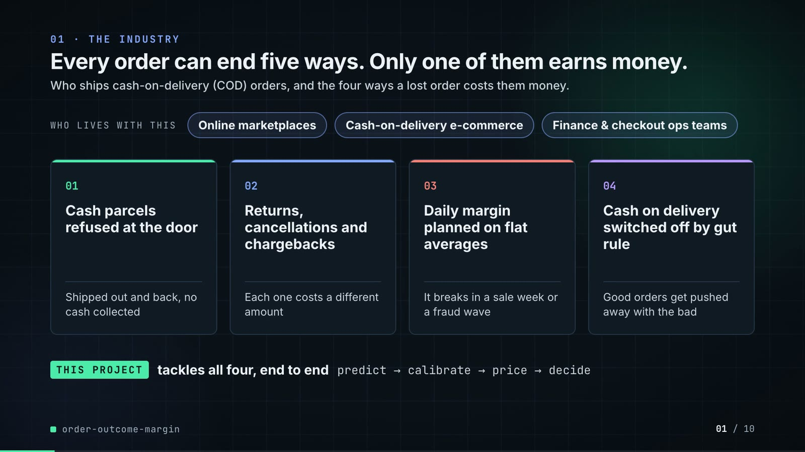

**On-screen text (verbatim)**

> 01 · THE INDUSTRY  
> Every order can end five ways. Only one of them earns money.  
> Who ships cash-on-delivery (COD) orders, and the four ways a lost order costs them money.  
> WHO LIVES WITH THIS · Online marketplaces · Cash-on-delivery e-commerce · Finance & checkout ops teams  
> 01 Cash parcels refused at the door — Shipped out and back, no cash collected  
> 02 Returns, cancellations and chargebacks — Each one costs a different amount  
> 03 Daily margin planned on flat averages — It breaks in a sale week or a fraud wave  
> 04 Cash on delivery switched off by gut rule — Good orders get pushed away with the bad  
> THIS PROJECT tackles all four, end to end · predict → calibrate → price → decide  

**Figures on this slide**

| ID | Shown | Source · key | Calculation | Check |
|---|---|---|---|---|
| F-01 | 3 chips | `author's framing; README 'The problem' (finance and operations teams)` · - | - | manual |
| F-02 | 4 problem cards | `README 'The problem'` · README lines 12-25 | - | ✓ |

**Assumptions:** A-11

**Illustrative, not data:**

- The whole slide is context; no repo figures.

**To change this slide:** Edit the subtitle (#ctx-sub), chips (#ctx-c1..3) and cards (#ctx-k1..4) in compositions/s01-context.html. (project folder `docs/demo/source`).

### Slide 02: This project  
*6.8-12.0 s · composition `compositions/s02-hook.html`*

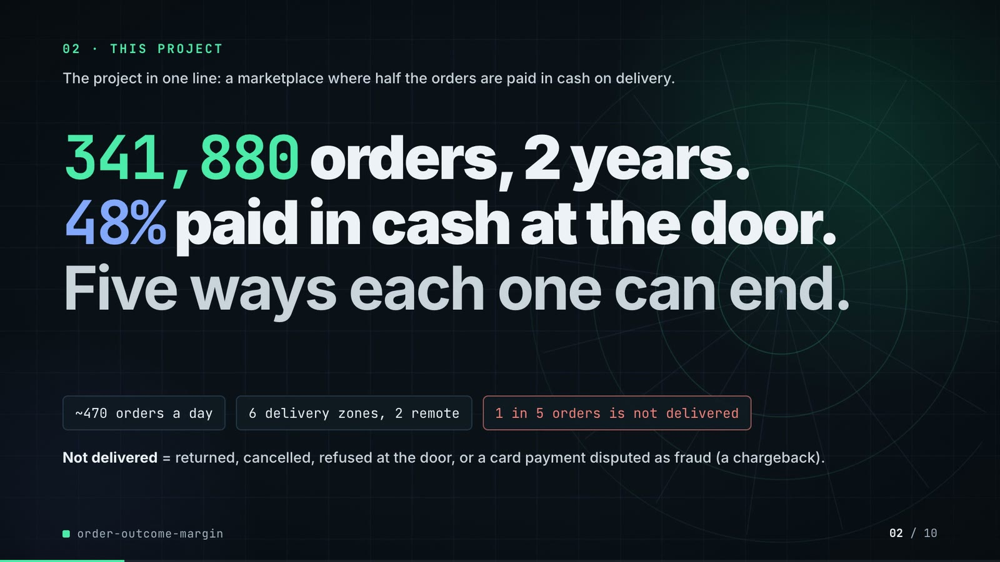

**On-screen text (verbatim)**

> 02 · THIS PROJECT  
> The project in one line: a marketplace where half the orders are paid in cash on delivery.  
> 341,880 orders, 2 years. 48% paid in cash at the door. Five ways each one can end.  
> ~470 orders a day · 6 delivery zones, 2 remote · 1 in 5 orders is not delivered  
> Not delivered = returned, cancelled, refused at the door, or a card payment disputed as fraud (a chargeback).  

**Figures on this slide**

| ID | Shown | Source · key | Calculation | Check |
|---|---|---|---|---|
| F-03 | 341,880 orders | `outputs/results.json` · orders_total | - | ✓ |
| F-04 | 2 years / 2024–2025 | `src/order_margin/config.py:70-71` · DATA_START, DATA_END | - | ✓ |
| F-05 | 48% | `data/orders.csv.gz` · payment == 'cod' | share of COD orders = 48.3% | ✓ |
| F-06 | Five ways each one can end / 5 ways it could end | `src/order_margin/config.py:11` · CLASSES | len = 5 | ✓ |
| F-07 | ~470 orders a day | `data/orders.csv.gz` · orders / distinct order days | 341,880 / 731 = 467.7, rounded to tens (README: 'around 470 orders a day') | ✓ |
| F-08 | 6 delivery zones, 2 remote | `src/order_margin/config.py:17-18` · ZONES, REMOTE_ZONES | - | ✓ |
| F-09 | 1 in 5 orders is not delivered | `data/orders.csv.gz` · outcome != delivered | 1 - 0.798 = 20.2% = 1 in 5 (test window: 20.9%) | ✓ |

**Assumptions:** A-01, A-10

**Illustrative, not data:**

- Rings in the background are decoration.

**To change this slide:** Headline spans #hook-l1..l3, chips #hook-f1..f3 and the definition #hook-def in compositions/s02-hook.html; volumes come from scripts/generate_data.py (make data). (project folder `docs/demo/source`).

### Slide 03: How it works (white chapter, slide A)  
*11.7-19.7 s · composition `compositions/explainer.html (CONFIG.blocks, CONFIG.groups, CONFIG.loop)`*

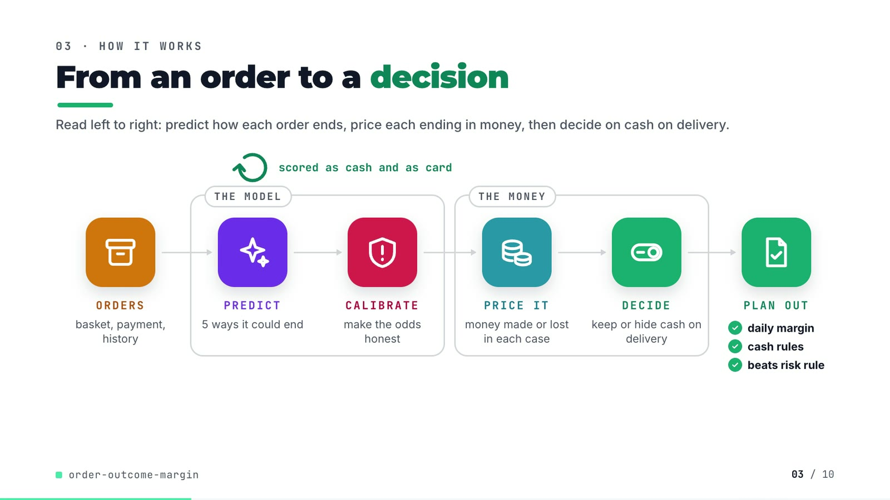

**On-screen text (verbatim)**

> 03 · HOW IT WORKS  
> From an order to a decision  
> Read left to right: predict how each order ends, price each ending in money, then decide on cash on delivery.  
> ORDERS basket, payment, history → [THE MODEL: PREDICT 5 ways it could end → CALIBRATE make the odds honest] → [THE MONEY: PRICE IT money made or lost in each case → DECIDE keep or hide cash on delivery] → PLAN OUT ✓ daily margin ✓ cash rules ✓ beats risk rule  
> scored as cash and as card (loop over PREDICT)  

**Figures on this slide**

| ID | Shown | Source · key | Calculation | Check |
|---|---|---|---|---|
| F-06 | Five ways each one can end / 5 ways it could end | `src/order_margin/config.py:11` · CLASSES | len = 5 | ✓ |
| F-10 | scored as cash and as card | `src/order_margin/pipeline.py:193-201` · with_payment(Xt_cod, 'card') | - | ✓ |
| F-11 | daily margin / cash rules / beats risk rule | `outputs/daily_margin.csv, outputs/results.json` · 122 daily rows; margin_minus_risk_rule > 0 | - | ✓ |
| F-12 | CALIBRATE · make the odds honest | `src/order_margin/calibration.py:26-39` · IsotonicCalibrator | - | ✓ |

**Assumptions:** A-02, A-03, A-06

**Illustrative, not data:**

- Icons and colours are a visual language, not data.

**To change this slide:** Edit CONFIG and #ex-a-sub in compositions/explainer.html; badge truth comes from F-11. (project folder `docs/demo/source`).

### Slide 04: The key idea (white chapter, slide B)  
*19.7-26.7 s · composition `compositions/explainer.html (#ex-b ...)`*

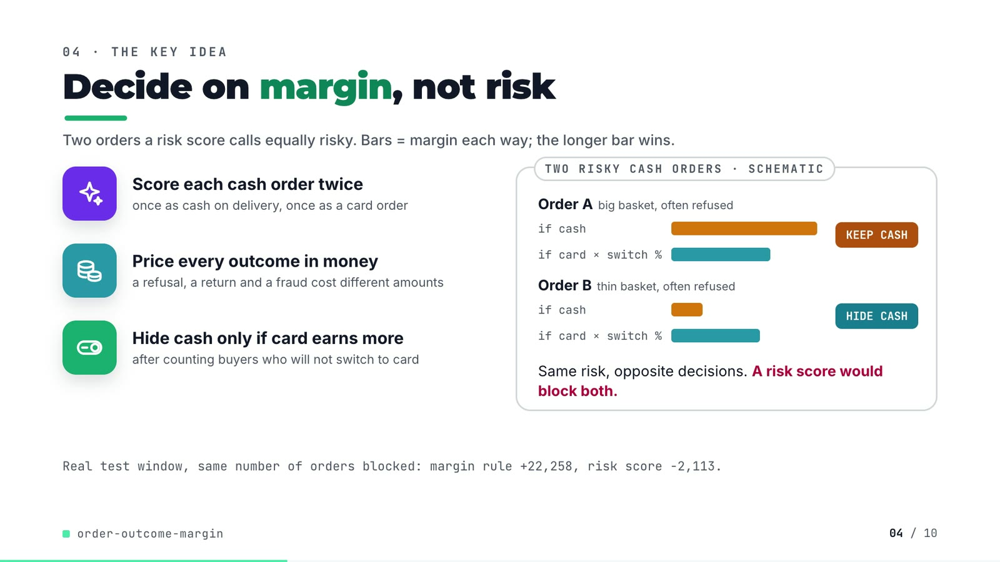

**On-screen text (verbatim)**

> 04 · THE KEY IDEA  
> Decide on margin, not risk  
> Two orders a risk score calls equally risky. Bars = margin each way; the longer bar wins.  
> Score each cash order twice — once as cash on delivery, once as a card order  
> Price every outcome in money — a refusal, a return and a fraud cost different amounts  
> Hide cash only if card earns more — after counting buyers who will not switch to card  
> TWO RISKY CASH ORDERS · SCHEMATIC: Order A big basket, often refused (if cash > if card × switch %) KEEP CASH; Order B thin basket, often refused (if cash < if card × switch %) HIDE CASH. Same risk, opposite decisions. A risk score would block both.  
> Real test window, same number of orders blocked: margin rule +22,258, risk score −2,113.  

**Figures on this slide**

| ID | Shown | Source · key | Calculation | Check |
|---|---|---|---|---|
| F-13 | +22,258 | `outputs/policy.csv` · policy='margin rule, gbm + isotonic', margin_change | - | ✓ |
| F-14 | −2,113 | `outputs/policy.csv` · policy='risk score, same block rate as margin rule on calib (14.6%)', margin_change | - | ✓ |

**Assumptions:** A-02, A-03, A-06

**Illustrative, not data:**

- Orders A and B and their bar lengths are schematic. Real rows with the same pattern are on slide 07 (order 316096: 41% refusal risk, KEEP COD; order 316309: 43%, HIDE COD).

**To change this slide:** Markup under #ex-b in compositions/explainer.html; the footnote figures are F-13 and F-14. (project folder `docs/demo/source`).

### Slide 05: Architecture  
*26.4-40.4 s · composition `compositions/s03-architecture.html (N nodes, W wires)`*

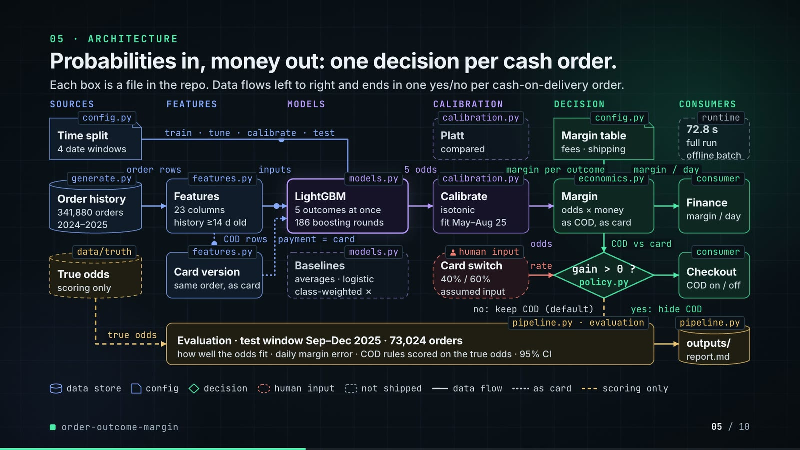

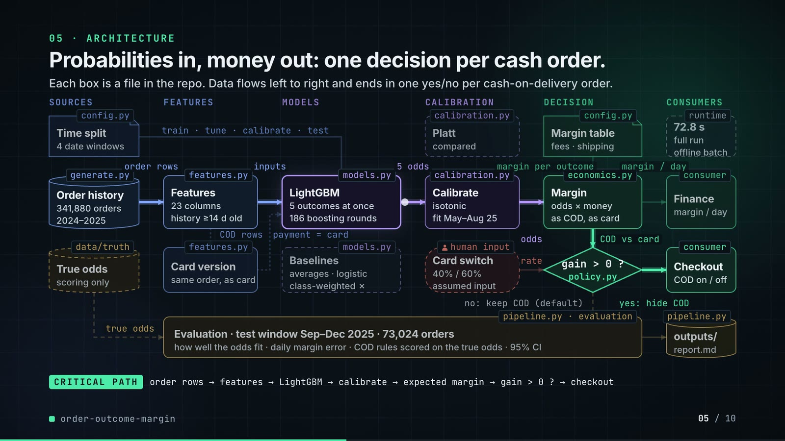

**On-screen text (verbatim)**

> 05 · ARCHITECTURE  
> Probabilities in, money out: one decision per cash order.  
> Each box is a file in the repo. Data flows left to right and ends in one yes/no per cash-on-delivery order.  
> Layers: SOURCES · FEATURES · MODELS · CALIBRATION · DECISION · CONSUMERS  
> config.py Time split (4 date windows) —train · tune · calibrate · test→ LightGBM  
> generate.py Order history (341,880 orders, 2024–2025) —order rows→ features.py Features (23 columns, history ≥14 d old) —inputs→ models.py LightGBM (5 outcomes at once, 186 boosting rounds) —5 odds→ calibration.py Calibrate (isotonic, fit May–Aug 25) —odds→ economics.py Margin (odds × money, as COD, as card) —margin / day→ Finance  
> features.py Card version (same order, as card): COD rows in, payment = card back into LightGBM (dotted, 2nd pass)  
> config.py Margin table (fees · shipping) —margin per outcome→ Margin; COD vs card → policy.py gain > 0 ? (yes: hide COD → Checkout, COD on / off; no: keep COD (default))  
> human input: Card switch (40% / 60%, assumed input) —rate→ gain > 0 ?  
> Ghost boxes (not shipped): Platt (compared), Baselines (averages · logistic, class-weighted ✗); runtime 72.8 s full run, offline batch  
> data/truth True odds (scoring only) —true odds→ pipeline.py evaluation: Evaluation · test window Sep–Dec 2025 · 73,024 orders · how well the odds fit · daily margin error · COD rules scored on the true odds · 95% CI → outputs/ (report.md)  
> Legend: data store · config · decision · human input · not shipped · data flow · as card · scoring only  
> CRITICAL PATH order rows → features → LightGBM → calibrate → expected margin → gain > 0 ? → checkout  

**Figures on this slide**

| ID | Shown | Source · key | Calculation | Check |
|---|---|---|---|---|
| F-03 | 341,880 orders | `outputs/results.json` · orders_total | - | ✓ |
| F-04 | 2 years / 2024–2025 | `src/order_margin/config.py:70-71` · DATA_START, DATA_END | - | ✓ |
| F-15 | config.py, generate.py, features.py, models.py, calibration.py, economics.py, policy.py, pipeline.py, data/truth | `src/order_margin/` · classes and functions | - | ✓ |
| F-16 | 23 columns | `src/order_margin/features.py:21-45` · NUMERIC (20) + CATEGORICAL (3) | 20 + 3 = 23 | ✓ |
| F-17 | history ≥14 d old | `src/order_margin/features.py:15` · RESOLVE_DAYS = 14 | - | ✓ |
| F-18 | 186 boosting rounds | `outputs/results.json` · gbm_rounds | - | ✓ |
| F-19 | 5 outcomes at once | `src/order_margin/models.py:74-75` · objective multiclass, num_class = N_CLASSES = 5 | - | ✓ |
| F-20 | fit May–Aug 25 | `src/order_margin/config.py:68-69` · EARLY_STOP_END 2025-04-30, CALIB_END 2025-08-31 | - | ✓ |
| F-21 | 40% / 60% · assumed input | `src/order_margin/config.py:75` · COD_TO_CARD_CONVERSION | - | ✓ |
| F-22 | 72.8 s | `outputs/results.json` · runtime_seconds | - | ✓ |
| F-23 | 73,024 orders | `outputs/results.json` · orders_test | - | ✓ |
| F-24 | how well the odds fit · daily margin error · COD rules scored on the true odds · 95% CI | `src/order_margin/pipeline.py:139-160, 274-275; calibration.py:64-83` · - | - | ✓ |
| F-25 | 4 date windows · train · tune · calibrate · test | `src/order_margin/pipeline.py:64-71` · split_masks keys | - | ✓ |

**Assumptions:** A-01, A-02, A-04, A-05, A-06, A-07

**Illustrative, not data:**

- Packets moving along the wires show execution order, not timing.
- 'Finance' and 'Checkout' are the consumers the README names (finance close, checkout COD option); the repo writes files, it does not call a checkout service.
- 'offline batch' describes how the repo runs (one CLI run over files); no serving latency is measured, so none is shown.
- In the critical-path phase the other boxes dim to 75% opacity (text stays above 4.5:1).

**To change this slide:** Node array N and wire array W in compositions/s03-architecture.html. (project folder `docs/demo/source`).

### Slide 06: The system running  
*40.0-54.6 s · composition `compositions/s04-routes.html (RUN block from tools/export_run.py + tools/inject_block.py)`*

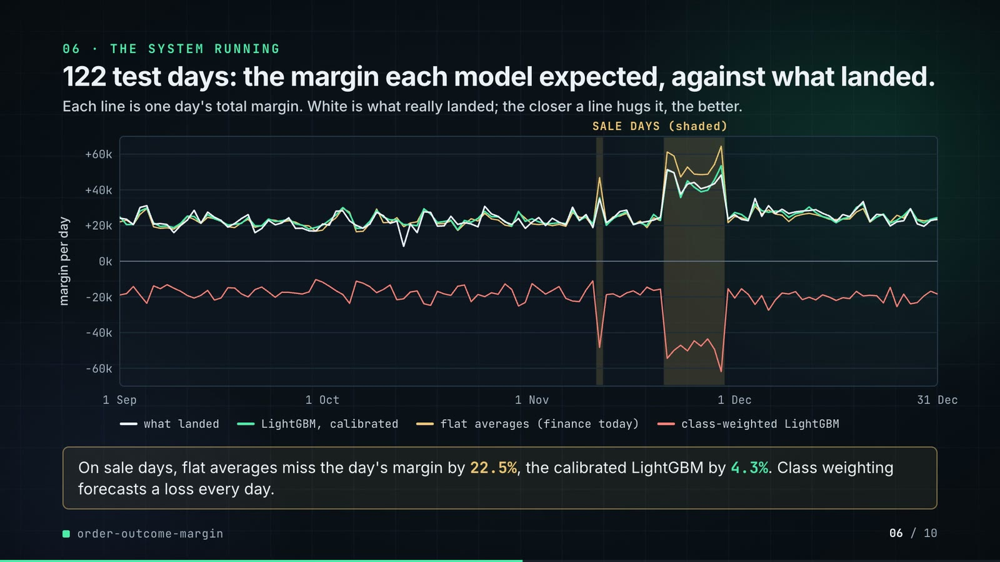

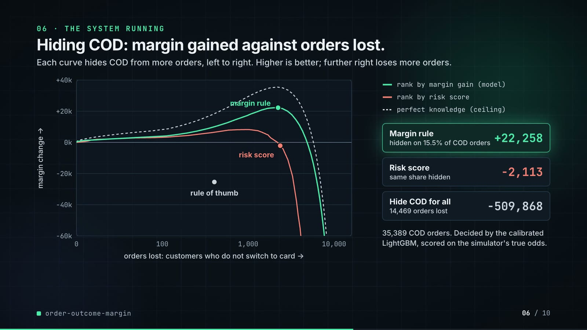

**On-screen text (verbatim)**

> 06 · THE SYSTEM RUNNING  
> 122 test days: the margin each model expected, against what landed.  
> Each line is one day's total margin. White is what really landed; the closer a line hugs it, the better.  
> y: margin per day (−60k … +60k) · x: 1 Sep … 31 Dec · SALE DAYS (shaded)  
> what landed · LightGBM, calibrated · flat averages (finance today) · class-weighted LightGBM  
> On sale days, flat averages miss the day's margin by 22.5%, the calibrated LightGBM by 4.3%. Class weighting forecasts a loss every day.  
> Hiding COD: margin gained against orders lost.  
> Each curve hides COD from more orders, left to right. Higher is better; further right loses more orders.  
> x: orders lost: customers who do not switch to card (0, 100, 1,000, 10,000) · y: margin change (−60k … +40k) · points: margin rule, risk score, rule of thumb  
> rank by margin gain (model) · rank by risk score · perfect knowledge (ceiling)  
> Margin rule (hidden on 15.5% of COD orders) +22,258 · Risk score (same share hidden) −2,113 · Hide COD for all (14,469 orders lost) −509,868  
> 35,389 COD orders. Decided by the calibrated LightGBM, scored on the simulator's true odds.  

**Figures on this slide**

| ID | Shown | Source · key | Calculation | Check |
|---|---|---|---|---|
| F-13 | +22,258 | `outputs/policy.csv` · policy='margin rule, gbm + isotonic', margin_change | - | ✓ |
| F-14 | −2,113 | `outputs/policy.csv` · policy='risk score, same block rate as margin rule on calib (14.6%)', margin_change | - | ✓ |
| F-26 | SVG line chart | `outputs/daily_margin.csv via tools/export_run.py -> assets/run.json -> RUN block in s04-routes.html` · realized, class priors, gbm + isotonic, gbm class-weighted, raw, peak | values rounded to whole units; drawn, not retyped | ✓ |
| F-27 | 122 test days | `outputs/results.json` · test_days | - | ✓ |
| F-28 | 22.5% | `outputs/metrics.csv` · model='class priors', daily_mape_peak (0.2254) | x 100 | ✓ |
| F-29 | 4.3% | `outputs/metrics.csv` · model='gbm + isotonic', daily_mape_peak (0.0431) | x 100 | ✓ |
| F-30 | Class weighting forecasts a loss every day. | `outputs/daily_margin.csv` · column 'gbm class-weighted, raw' max = -10,259 | max < 0 | ✓ |
| F-31 | SVG line chart, y clipped to -60k..+40k | `outputs/policy_frontier.csv, outputs/policy.csv via tools/export_run.py` · orders_lost, margin_change per ranking; policy rows | same symlog x-axis as plots.py (linear below 100) | ✓ |
| F-32 | −509,868 | `outputs/policy.csv` · policy='block every COD order', margin_change | - | ✓ |
| F-33 | 14,469 orders lost | `outputs/policy.csv` · orders_lost = 14,468.6 | rounded | ✓ |
| F-34 | hidden on 15.5% of COD orders | `outputs/policy.csv` · policy='margin rule, gbm + isotonic', blocked_share_of_cod (0.1554) | x 100 | ✓ |
| F-35 | 35,389 COD orders | `outputs/results.json` · cod_orders_test | - | ✓ |
| F-36 | Risk score · same block rate | `src/order_margin/pipeline.py:206-218` · threshold_for_share(risk_score(pc_c), share) | - | ✓ |

- *F-31 note:* Curves leave the bottom of the chart; 'hide COD for all' (-509,868) is off the chart and shown in the panel.

**Assumptions:** A-02, A-03, A-04, A-06, A-09

**Illustrative, not data:**

- Both charts are drawn as SVG from the repo's CSVs (F-26, F-31); no value is typed by hand.
- The frontier's y axis is clipped to −60k…+40k so the useful top band is readable; curves leave the bottom, and 'hide COD for all' is reported in the panel instead.

**To change this slide:** Re-run tools/export_run.py and tools/inject_block.py after make run; captions and panel text in compositions/s04-routes.html. (project folder `docs/demo/source`).

### Slide 07: End-user value (white)  
*54.3-67.3 s · composition `compositions/value.html (SHEET block injected by tools/inject_sheet.py)`*

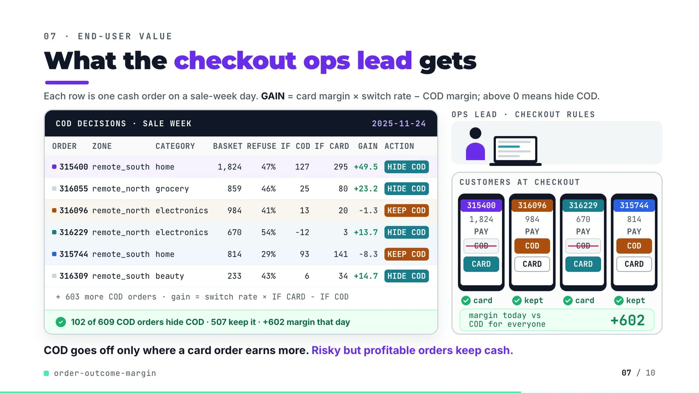

**On-screen text (verbatim)**

> 07 · END-USER VALUE  
> What the checkout ops lead gets  
> Each row is one cash order on a sale-week day. GAIN = card margin × switch rate − COD margin; above 0 means hide COD.  
> COD DECISIONS · SALE WEEK · 2025-11-24 — columns ORDER, ZONE, CATEGORY, BASKET, REFUSE, IF COD, IF CARD, GAIN, ACTION  
> 315400 remote_south home 1,824 47% 127 295 +49.5 HIDE COD  
> 316055 remote_north grocery 859 46% 25 80 +23.2 HIDE COD  
> 316096 remote_north electronics 984 41% 13 20 −1.3 KEEP COD  
> 316229 remote_north electronics 670 54% −12 3 +13.7 HIDE COD  
> 315744 remote_south home 814 29% 93 141 −8.3 KEEP COD  
> 316309 remote_south beauty 233 43% 6 34 +14.7 HIDE COD  
> + 603 more COD orders · gain = switch rate × IF CARD − IF COD · ✓ 102 of 609 COD orders hide COD · 507 keep it · +602 margin that day  
> OPS LEAD · CHECKOUT RULES · CUSTOMERS AT CHECKOUT (4 phones: order id, basket, PAY COD / CARD) · card / kept · margin today vs COD for everyone +602  
> COD goes off only where a card order earns more. Risky but profitable orders keep cash.  

**Figures on this slide**

| ID | Shown | Source · key | Calculation | Check |
|---|---|---|---|---|
| F-37 | SALE WEEK · 2025-11-24 | `demo assets/cod_sheet.json; src/order_margin/generate.py:30` · day, is_peak | - | ✓ |
| F-38 | 609 COD orders (6 rows + 603 more) | `demo assets/cod_sheet.json; data/orders.csv.gz` · cod_orders; COD orders placed on 2025-11-24 | - | ✓ |
| F-39 | 102 of 609 COD orders hide COD · 507 keep it | `demo assets/cod_sheet.json` · blocked, kept | 102 + 507 = 609 | ✓ |
| F-40 | +602 margin that day | `demo assets/cod_sheet.json` · day_true_gain | sum over hidden orders of conv x E_true[card] - E_true[cod] | ✓ |
| F-41 | 315400, 316055, 316096, 316229, 315744, 316309 | `demo assets/cod_sheet.json, injected into compositions/value.html` · rows | gain = conv x IF CARD - IF COD; action = HIDE COD if gain > 0 | ✓ |
| F-42 | (consistency check, not on screen) | `demo assets/cod_sheet.json; outputs/policy.csv` · test_window_blocked vs policy 'margin rule, gbm + isotonic' cod_orders_blocked | 5,498 = 5,498; 186 rounds = 186 | ✓ |
| F-43 | + 603 more COD orders | `F-38` · 609 - 6 rows | 609 - 6 = 603 | ✓ |

**Assumptions:** A-02, A-03, A-06, A-07

**Illustrative, not data:**

- Ops-lead figure, laptop, phones and tokens are illustrative; no real people.
- The four phones show four of the six rows (two hidden, two kept), chosen to show both decisions. Order ids are the generator's synthetic ids.
- 'card' under a phone means the order is offered card only; whether that customer converts is the 40/60% assumption (A-02).
- IF COD / IF CARD are the model's expected margins; the day total (+602) is scored on true probabilities, like the repo's policy table.

**To change this slide:** Re-run tools/export_cod_sheet.py, then tools/inject_sheet.py (--rows / --animate pick the orders); layout in compositions/value.html. (project folder `docs/demo/source`).

### Slide 08: Results  
*67.0-75.8 s · composition `compositions/s05-results.html (stats array)`*

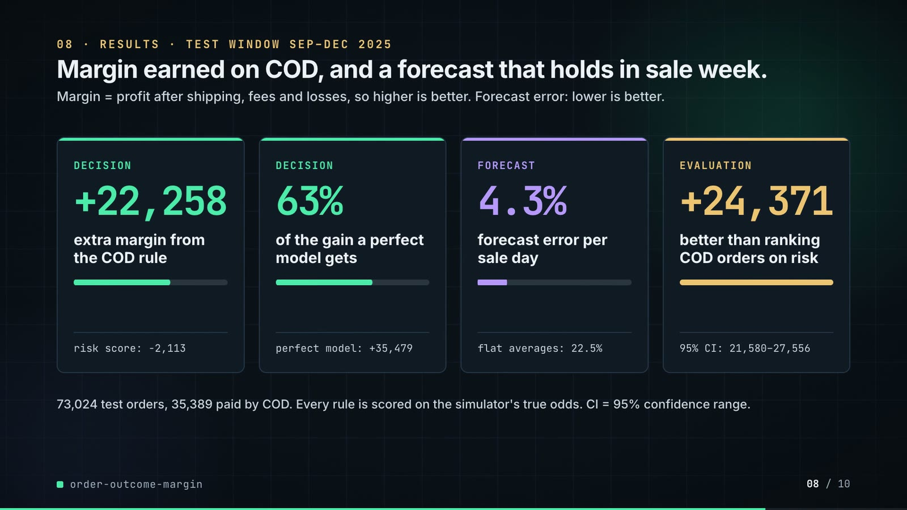

**On-screen text (verbatim)**

> 08 · RESULTS · TEST WINDOW SEP–DEC 2025  
> Margin earned on COD, and a forecast that holds in sale week.  
> Margin = profit after shipping, fees and losses, so higher is better. Forecast error: lower is better.  
> DECISION +22,258 extra margin from the COD rule · risk score: −2,113  
> DECISION 63% of the gain a perfect model gets · perfect model: +35,479  
> FORECAST 4.3% forecast error per sale day · flat averages: 22.5%  
> EVALUATION +24,371 better than ranking COD orders on risk · 95% CI: 21,580–27,556  
> 73,024 test orders, 35,389 paid by COD. Every rule is scored on the simulator's true odds. CI = 95% confidence range.  

**Figures on this slide**

| ID | Shown | Source · key | Calculation | Check |
|---|---|---|---|---|
| F-13 | +22,258 | `outputs/policy.csv` · policy='margin rule, gbm + isotonic', margin_change | - | ✓ |
| F-14 | −2,113 | `outputs/policy.csv` · policy='risk score, same block rate as margin rule on calib (14.6%)', margin_change | - | ✓ |
| F-23 | 73,024 orders | `outputs/results.json` · orders_test | - | ✓ |
| F-28 | 22.5% | `outputs/metrics.csv` · model='class priors', daily_mape_peak (0.2254) | x 100 | ✓ |
| F-29 | 4.3% | `outputs/metrics.csv` · model='gbm + isotonic', daily_mape_peak (0.0431) | x 100 | ✓ |
| F-35 | 35,389 COD orders | `outputs/results.json` · cod_orders_test | - | ✓ |
| F-44 | 63% | `outputs/policy.csv` · margin rule 22,258 / true-probability ceiling 35,479 | 22,258 / 35,479 = 62.7% | ✓ |
| F-45 | perfect model: +35,479 | `outputs/policy.csv` · policy='margin rule, true probabilities (ceiling)', margin_change | - | ✓ |
| F-46 | +24,371 | `outputs/results.json` · margin_minus_risk_rule | - | ✓ |
| F-47 | 95% CI: 21,580–27,556 | `outputs/results.json` · margin_minus_risk_rule_ci95 | - | ✓ |

**Assumptions:** A-02, A-03, A-06, A-08, A-09, A-10

**Illustrative, not data:**

- Mini bars: cards 1-2 = 22,258 / 35,479; card 3 = 4.3 / 22.5; card 4 is a full bar (no ratio).

**To change this slide:** The stats array and card text in compositions/s05-results.html. (project folder `docs/demo/source`).

### Slide 09: Lesson and fix  
*75.4-84.4 s · composition `compositions/s06-twist.html`*

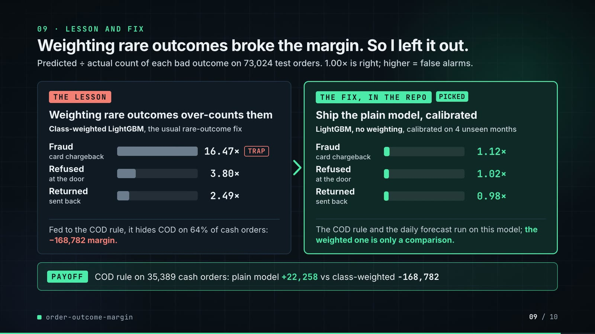

**On-screen text (verbatim)**

> 09 · LESSON AND FIX  
> Weighting rare outcomes broke the margin. So I left it out.  
> Predicted ÷ actual count of each bad outcome on 73,024 test orders. 1.00× is right; higher = false alarms.  
> THE LESSON · Weighting rare outcomes over-counts them · Class-weighted LightGBM, the usual rare-outcome fix · Fraud (card chargeback) 16.47× TRAP · Refused (at the door) 3.80× · Returned (sent back) 2.49×  
> Fed to the COD rule, it hides COD on 64% of cash orders: −168,782 margin.  
> THE FIX, IN THE REPO · PICKED · Ship the plain model, calibrated · LightGBM, no weighting, calibrated on 4 unseen months · Fraud 1.12× · Refused 1.02× · Returned 0.98×  
> The COD rule and the daily forecast run on this model; the weighted one is only a comparison.  
> PAYOFF · COD rule on 35,389 cash orders: plain model +22,258 vs class-weighted −168,782  

**Figures on this slide**

| ID | Shown | Source · key | Calculation | Check |
|---|---|---|---|---|
| F-13 | +22,258 | `outputs/policy.csv` · policy='margin rule, gbm + isotonic', margin_change | - | ✓ |
| F-23 | 73,024 orders | `outputs/results.json` · orders_test | - | ✓ |
| F-35 | 35,389 COD orders | `outputs/results.json` · cod_orders_test | - | ✓ |
| F-48 | 16.47× | `outputs/metrics.csv` · model='gbm class-weighted, raw', count_ratio_fraud | - | ✓ |
| F-49 | 3.80× | `outputs/metrics.csv` · model='gbm class-weighted, raw', count_ratio_failed | - | ✓ |
| F-50 | 2.49× | `outputs/metrics.csv` · model='gbm class-weighted, raw', count_ratio_returned | - | ✓ |
| F-51 | 1.12× | `outputs/metrics.csv` · model='gbm + isotonic', count_ratio_fraud | - | ✓ |
| F-52 | 1.02× | `outputs/metrics.csv` · model='gbm + isotonic', count_ratio_failed | - | ✓ |
| F-53 | 0.98× | `outputs/metrics.csv` · model='gbm + isotonic', count_ratio_returned | - | ✓ |
| F-54 | 64% of cash orders | `outputs/policy.csv` · policy='margin rule, class-weighted gbm', blocked_share_of_cod (0.6393) | x 100 | ✓ |
| F-55 | −168,782 | `outputs/policy.csv` · policy='margin rule, class-weighted gbm', margin_change | - | ✓ |
| F-56 | bars 260 / 60 / 39 px (lesson) and 18 / 16 / 15 px (fix) | `outputs/metrics.csv` · count_ratio_* / max x 260 | round(ratio / 16.4749 x 260) | ✓ |
| F-61 | Ship the plain model, calibrated · PICKED · the weighted one is only a comparison | `src/order_margin/models.py:71; pipeline.py:122, 180, 203, 229, 252; tests/test_pipeline.py:24` · - | - | ✓ |

**Assumptions:** A-02, A-03, A-06, A-07, A-10, A-12

**Illustrative, not data:**

- Bars use one shared scale, 16.47× = 260 px (F-56); bars are neutral grey on the lesson side and mint for the shipped model.

**To change this slide:** Rows #twist-l1..l3 / #twist-r1..r3 (bar widths are inline styles) and the payoff strip in compositions/s06-twist.html. (project folder `docs/demo/source`).

### Slide 10: End card  
*84.0-88.4 s · composition `compositions/s07-end.html`*

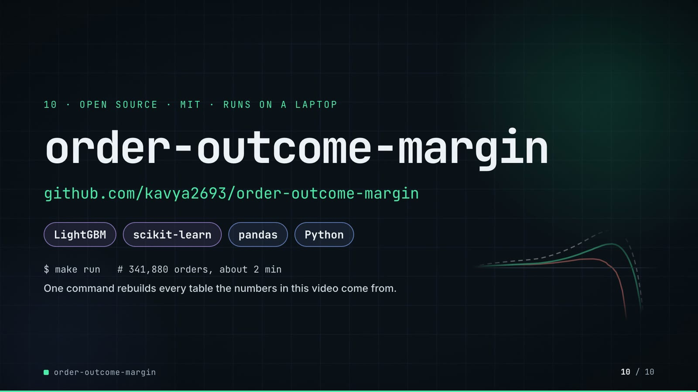

**On-screen text (verbatim)**

> 10 · OPEN SOURCE · MIT · RUNS ON A LAPTOP  
> order-outcome-margin  
> github.com/kavya2693/order-outcome-margin  
> LightGBM · scikit-learn · pandas · Python  
> $ make run   # 341,880 orders, about 2 min  
> One command rebuilds every table the numbers in this video come from.  

**Figures on this slide**

| ID | Shown | Source · key | Calculation | Check |
|---|---|---|---|---|
| F-57 | MIT | `LICENSE line 1` · - | - | ✓ |
| F-58 | about 2 min | `README.md line 137` · 'about 2 minutes on a laptop' | - | ✓ |
| F-59 | LightGBM · scikit-learn · pandas · Python | `pyproject.toml dependencies` · lightgbm, scikit-learn, pandas | - | ✓ |
| F-60 | $ make run | `Makefile` · run target | - | ✓ |

**Assumptions:** A-10

**Illustrative, not data:**

- Faded curves in the corner are the COD frontier from outputs/policy_frontier.csv, drawn without text by tools/make_end_plot.py.

**To change this slide:** Text in compositions/s07-end.html. (project folder `docs/demo/source`).

## 5. Change-impact matrix

| Input / assumption | Affected figures | Affected slides | Files to edit | Commands to re-run |
|---|---|---|---|---|
| A-01: All data is synthetic, produced by a seeded generator sized to the production problem (341,880 orders over 2024-2025, six zones, five categories, COD about 48%) | all figures | 01, 02, 03, 04, 05, 06, 07, 08, 09, 10 | `src/order_margin/generate.py; src/order_margin/world.py` | `make data; make run` |
| A-02: Card conversion: 40% of blocked customers younger than 30 days and 60% of the rest switch to a card | F-13, F-14, F-21, F-32, F-33, F-34, F-39, F-40, F-41, F-44, F-45, F-46, F-47, F-54, F-55 | 04, 05, 06, 07, 08, 09 | `src/order_margin/config.py:75` | `make run; export_cod_sheet.py + inject_sheet.py` |
| A-03: Unit economics are one table per category (gross margin, resale loss, shipping legs, COD/card/wallet fees, a 45 chargeback fee) | F-13, F-14, F-28, F-29, F-30, F-32, F-40, F-41, F-44, F-45, F-46, F-47, F-55 | 04, 06, 07, 08, 09 | `src/order_margin/config.py:22-60` | `make run; export_cod_sheet.py + inject_sheet.py` |
| A-04: Time split: train 2024-01-01 | F-20, F-23, F-25, F-27, F-28, F-29, F-35, F-48, F-49, F-50, F-51, F-52, F-53 | 05, 06, 08, 09 | `src/order_margin/config.py:67-71` | `make run` |
| A-05: Outcomes are known 14 days after the order; customer history features only use orders placed at least 14 days earlier, shrunk towards fixed long-run rates | F-17 | 05 | `src/order_margin/features.py:15` | `make run` |
| A-06: COD policies are scored on the generator's true outcome probabilities under COD and under card (data/truth/order_truth | F-13, F-14, F-32, F-40, F-44, F-45, F-46, F-47, F-55 | 04, 06, 07, 08, 09 | `src/order_margin/pipeline.py` | `make run` |
| A-07: LightGBM settings: multiclass, learning rate 0 | F-18, F-19, F-48, F-49, F-50, F-51, F-52, F-53 | 05, 09 | `src/order_margin/models.py:71-89` | `make run` |
| A-08: One seed and one test window | F-46, F-47 | 08 | `src/order_margin/config.py:78` | `make data; make run` |
| A-09: 'Sale days' = days flagged is_peak: the November sale week (2025-11-21 | F-28, F-29, F-37, F-26 | 06, 07, 08 | `src/order_margin/generate.py:30-31` | `make data; make run` |
| A-10: Video rounding: margins to whole units with thousands separators, percentages to 1 decimal (63%, 48% and 64% to whole numbers), predicted/actual count ratios to 2 decimals; chart axes in thousands ('+20k'); '~470 a day' and 'about 2 min' are rounded labels | F-05, F-07, F-09, F-22, F-28, F-29, F-34, F-44, F-48, F-49, F-50, F-51, F-52, F-53, F-54, F-58 | 02, 05, 06, 08, 09, 10 | `the composition file named on each slide` | `hyperframes render` |
| A-11: Slide 01 (industry, everyday problems) is general e-commerce knowledge used as context, matched to the README problem statement | F-01, F-02 | 01 | `compositions/s01-context.html` | `hyperframes render` |
| A-12: The shipped model is the plain (unweighted) LightGBM with an isotonic calibrator fitted on May-Aug 2025, a window the booster never trained or early-stopped on | F-48, F-49, F-50, F-51, F-52, F-53, F-54, F-55, F-61 | 09 | `src/order_margin/pipeline.py:203; src/order_margin/models.py:71` | `make run` |

## 6. Known differences and caveats

- The COD gain rests on an assumed card conversion (40% / 60%). With decisions fixed, 20 points lower conversion breaks even and 30 points lower loses 9,714 (outputs/conversion_sensitivity.csv, A-02). The README names this the biggest gap.
- Policies are scored on the generator's true probabilities, which only exist because the data is synthetic (A-06). On real data the same comparison needs a randomised checkout holdout.
- Orders lost are counted, not priced: a customer pushed away may not come back (README 'Known limitations').
- 'Sale days' in the 22.5% / 4.3% figures include 11.11 as well as the Nov 21-29 sale week; slide 06 shades all ten days (A-09).
- Slide 09's payoff compares the class-weighted model without calibration (the repo's 'margin rule, class-weighted gbm') against the shipped LightGBM + isotonic. The plain booster without calibration scores +22,405 (outputs/policy.csv 'margin rule, uncalibrated gbm'), so the gap comes from the weighting, not from calibration.
- Slide 09 no longer shows two narrower results the README still reports under 'What didn't win' and 'The result': LightGBM barely beats logistic regression (log-loss 0.6469 vs 0.6475), and isotonic calibration did nothing for the plain booster (ECE 0.0027 -> 0.0035). Isotonic did repair the class-weighted model (ECE 0.206 -> 0.009) but its margin stayed 4.2% off.
- Slide 07 rows come from a re-run of the repo's own model for 2025-11-24 (tools/export_cod_sheet.py); the re-run reproduces the repo's 186 rounds and its 5,498 hidden COD orders over the test window exactly (F-42).
- The architecture's 'Finance' and 'Checkout' are the README's consumers; the repo itself writes files (outputs/) and runs as one offline batch. No serving latency exists, so none is shown.
- Slide 01 statements are general industry knowledge (A-11).

## Appendix: environment

- Commit: `e78d53a391889af780be9f07f440398e04edc426`
- Python: 3.11.7
- lightgbm 4.7.0
- sklearn 1.9.1
- pandas 3.0.6
- numpy 2.4.6
- Profile / seeds: data_seed=20260913, lightgbm_seed=7, bootstrap_seed=0
- Run time: results.json runtime_seconds = 72.8 s for the pipeline (make run also generates the data first; README says about 2 minutes on a laptop)
